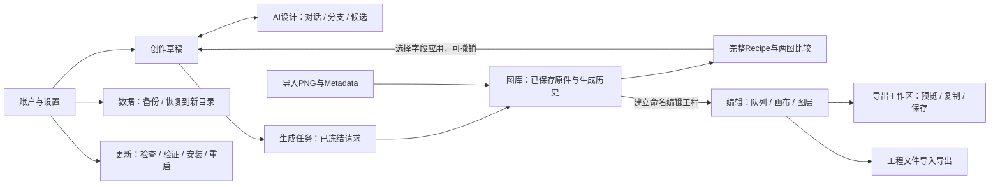

# UX-R0 — GUI 结构与完整工作流合同（提案 v1）

**DRAFT FOR PROJECT REVIEW；尚未批准实施。** 本文图示是拟议界面结构，不是实现截图。对应 [56项差距](UX_R0_PARITY_MATRIX.md) 与 [实施计划](UX_RECOVERY_IMPLEMENTATION_PLAN.md)。产品仍为 HOLD / NOT ACCEPTED。

范围按Issue #4最新FULL SOURCE ADOPTION：完整NAI Studio＋完整TypeSet 1.1＋Suite整合；小人书/连环画/PDF包含在W4与编辑工作台，不能默认延期。优先适配Desktop成熟Compose组件与状态流程；TypeSet用原生渲染/持久化等位替代，不嵌WebView。下列布局统一外壳，不授权简化源功能。

## 1. 产品对象与信息架构

用户应能回答“我在编辑什么、影响哪些图、是否已保存、下一步去哪”。主导航只有 **创作 / 图库 / 编辑**；AI设计是创作内具有独立空间的子工作台，比较是图库的独立视图。账户、数据与更新放统一设置，任务状态始终可达。记录不再是塞满JSON的第三个Inspector。



|对象|用户可见名称及含义|保存/关系规则|
|---|---|---|
|资产|原始图片；导入或最终生成得到的不可变字节|入库完成才显示“已保存”；SHA/size可在详情查看；中间预览不当原件|
|创作草稿|当前准备发给模型的分段Prompt、角色、参数、引导|本地自动保存；修改不改历史Recipe；切页/窄宽切换不重置|
|设计会话|用户需求、AI回复、分支、哪些候选已应用|与草稿分离；逐轮应用有差异预览，不自动覆盖手改|
|生成任务/Recipe|一次请求的模型/账号身份、实际有效参数、最终Prompt和结果关联|发送前冻结；重试是新任务，历史不可就地改写；密钥不入Recipe|
|编辑工程|命名的图片队列、每页图层、排版、历史|引用原件；“从所选N张建立工程”明确说明，不复制或重写原件|
|导出副本|指定模式/目的地的派生结果|记录工程修订/输入原件/模式/hash；不得称原件被保存或覆盖|
|预设|可复用样式或参数模板|与文字内容/像素/密钥分开；工程交换可携带引用和明确获准的素材|

顶栏持续显示蓝色CCB logo，所有应用自有辅助窗口保持同一标识。可见任务状态与当前账号摘要不能用颜色作为唯一信息。全局状态栏区分“草稿已保存”“工程已保存”“正在生成”“结果已入库”“导出部分完成”，不以统一“完成”代替。

## 2. 五条端到端故事

### W1：真实账户 → 设计/修订 → 完整确认 → 生成 → 入库

1. 首次进入“创作”，空状态提供“设置LLM账户”“设置NovelAI账户”“导入图片”，样例放帮助/演示，不能默认假装真实账户。档案页有别名、provider、endpoint、有效模型、密钥受保护输入；LLM和NAI选择独立。验证连接必须显示是否发出网络/可能计费，不能在每次启动自动付费探测。
2. 点“AI设计”，进入会话工作台。左为历史/分支，中为多轮对话，右为所选回复的结构化候选；底部固定需求输入与发送/停止。显示实际LLM身份，允许附加当前Studio基础/角色Prompt，明确哪些上下文会发送。
3. 回复支持展开完整正负向/角色、编辑本轮需求并分支、重新设计、继续修改。点击“应用到创作草稿”显示字段差异和覆盖范围；确认后回到创作，保留会话。未应用候选不会偷偷进入请求。
4. 创作内按“Prompt / 角色与位置 / 图像引导 / 生成设置”查看完整草稿。画风/基础/补充/负面词可全文编辑和Tag补全；角色为卡片，顺序、启用、正负词、位置有明确控件；不能依赖JSON。引导基图/聚焦/蒙版与精确参考/Vibe有独立可视工作区。
5. 固定生成栏显示NAI档案、实际模型、尺寸/数量、成本或“估算不可用”、节流等待原因。生成前可打开“查看实际请求摘要”，普通用户看到完整字段，诊断展开才看脱敏JSON。无效参数定位原字段，不能静默改模型或fallback。
6. 点击生成，冻结请求快照并登记任务。中间图标“生成中·未保存”，保留之前选择的原件。停止后标“取消请求/已停止接收/远端结果不确定”等实际状态。断线不自动补发、不隐式换账户。
7. 每个收到的最终原件完成事务后出现在结果条和“图库→最近生成”；当前工程是否打开不影响它可见。完成摘要显示已保存N/目标M，可“查看图库 / 新种子重绘 / 复用Seed / 用作引导 / 加入编辑工程”。保存失败保留可恢复内容与任务，不显示完整成功。

**完成点：** 从分发包的正常GUI经真实provider路径得到结果、在图库可见、重启可找回来源/Recipe；loopback全流程是独立工程证据，不能替代真实使用签字。历史两次provider探针不满足此故事。

### W2：PNG导入 → 读/选择metadata → 回用草稿

图库“导入”支持文件/拖放/图片剪贴板，逐项显示成功/不支持/读错；成功后聚焦新资产。点击“参数与来源”显示来源格式、完整字段、可用性，不直接弹JSON。点击“应用到创作”进入选择页：正向各段、负向、生成参数、Seed分别勾选；角色模式“关 / 覆盖 / 新增”；参考资源缺失有提示，不声称可精确复现。预览现值→候选值后应用，草稿可撤销。

不识别的metadata字段保留在原始字节和只读扩展详情，不填造默认值。格式损坏与没有metadata分开；原图正常可读时仍可查看/导出。APNG需要动画识别与“还原/用作静态帧”显式选择，不能静默取首帧并冒充原件。反推图片从此页进入W1候选流程，不自动调用付费模型。

**完成点：** 原始hash未变，所选字段与完整角色语义正确进入草稿；取消不改，应用可撤销，生成使用确认后的快照。

### W3：两图研究比较 → 选择差异 → 复用

图库Ctrl选择两张→“比较2张”。比较页同时显示A/B图、锁定或独立缩放开关；下方字段表固定A/B身份与来源，允许“仅差异/全部字段”。字段完整包含分段正负Prompt、角色顺序/启用/位置、模型、Seed、尺寸、Steps、CFG/Rescale、Sampler、数量、参考/Vibe、实际请求与原图身份。缺失、空值、未知版本不得视为相同。

字段表能搜索、换行、复制某一字段/完整Recipe，并选择“A侧字段应用到草稿”或“B侧字段应用”；显示冲突确认，绝不混合两个结果后冒称历史Recipe。可用A/B快捷键切换大图，但不可只剩一张图与JSON弹框。

**完成点：** 用户能看到图像差异并定位对应完整参数；回用后关联新草稿来源；原Recipe与原图不变。无Recipe的导入图仍可比像素，字段显示缺失而非拒绝整个比较页。

### W4：多图队列 → 排版/打码 → 批量预览/交付 → 再编辑

1. 图库选图→“新建编辑工程（N张）”→命名与顺序确认；已有工程可“加入所选图片”。打开后左队列、中画布、右对象属性与图层。工程名旁显示保存状态，解释“编辑保存自动完成；导出生成副本”。
2. 队列单击聚焦并单选，Ctrl切换，Shift选范围；勾选框只切换选择不跳图。全选/全不选/反选明确作用于当前可见队列；筛选改变时显示隐藏已选数量，批量开始必须列出实际目标。拖动多选保持相对顺序，顶/底/指定位置为菜单操作。
3. 选择工具可点选、拖动、调整文本框；按空格临时平移，滚轮缩放有明确修饰键规则，适应/100%固定可达。任何缩放和DPI下，操作坐标落到同一源图区域。拖绘过程实时显示形状/笔宽和效果，不等松手才出现无来源结果。
4. 选中文字框后属性直接绑定该对象。修改文字、字体、颜色、横竖排、框尺寸即时预览；拖拽/连续输入合并为可理解的撤销动作。无选择时属性标题“新建文本默认样式”，避免混淆。缺字体告警给替代选择，保存工程允许保留引用，导出不能静默替换。
5. 横排自动按框宽换行；竖排按框高从上到下、列从右到左。中日文标点、已竖排字形、ASCII全角显示与混合样式有固定样例；显示变换不修改原始文字。提供可见边界/溢出告警，不以一句“支持竖排”交差。局部富文本使用可视选区工具，源码标签仅高级导入选项。
6. 矩形/画笔/圈选是形状；马赛克/模糊/黑条/白条是效果；笔宽/强度/密度按适用类型显示。图层可选/锁定/显隐/重排/移除。文本和打码默认作用于当前页；多选图片不会让一次拖绘悄悄作用到所有页。
7. 点“批量应用样式”列出目标与预览，仅更改已有对象样式、保留每图内容和位置；“套用各自上一张样式”从操作前队列快照取各自前一页。复制内容/图层是另一项明确命令，说明按绝对或归一化坐标，并预览越界。一次批次可整体撤销，取消不会留半批未说明的修改。
8. 导出工作区先选当前/所选/全队列，再选分类与格式、metadata策略、命名与目的地；前后预览与每类样张必须可看。确认后串行输出并有逐文件状态、完成清单/校验；部分失败不显示全成功，可从明确失败项重新导出，不能覆盖原图。复制/保存不是同一按钮的隐式副作用。
9. 关闭后重开工程，顺序/文字样式/对象位置/历史边界可恢复；“导出工程”可在新目录导入再编辑。工程/预设交换不包含凭据；有外部字体或参考资源时列出依赖与缺失，不随意打包授权不明的字体。
10. 切换“图片编辑 / 小人书”，仍使用同一队列与原件，图片已有打码/文字参与小人书合成。小人书图在上、旁白在下；旁白输入与页面高度随内容增长，原图字节不变。传统/简洁/复古样式可选；页面宽度、页边距、图文间距、文字内边距/最小高、字体/字号/行距/对齐/颜色、纸色/边框、段首缩进与页码均可编辑。样式可作用所选/全册但保留每页文字；Ctrl+Enter到下一页，上一页/下一页预览保持次序。当前页、整册文件夹、整册ZIP和可变页高PDF均有入口及进度；合成页不伪装成带原始NAI隐写的单张生成图。保存工程后重开恢复模式、每页旁白、样式、编号；PDF只是输出，不能替代可再编辑工程。

**完成点：** 多张图完成可用排版和遮盖，批量结果与预览一致、原字节不变、可继续编辑；真人审美判断集中进行，不靠基础矩形测试代签。

### W5：保存退出 → 恢复/备份 → 完整安全更新

用户关闭时先保存草稿/工程并显示活动任务；允许等待或明确取消，不能提前释放根锁。下次启动恢复已提交状态，运行中任务转不确定，不重发付费请求。数据页可“创建备份”→显示可验证完成标记与范围（凭据不导出）→“恢复备份到新目录”→验证预览→“打开恢复后的工作区”，无需用户手写命令；失败保留原根和备份。

设置→更新：检查版本/渠道/变更→确认下载→来源及签名/产品/平台/版本验证→保存与维护排水→退出→真实安装→重启→程序版本与数据/凭据引用检查→显示结果。失败展示可恢复状态和安全回退动作；不能用校验zip后启动现有程序冒称升级。CP4必须用隔离A→B安装和测试签名跑完，见实施方案。更新UI设计可参考系统惯例，但完整安全要求高于Desktop既有更新入口。

## 3. 宽窗/窄窗结构（逻辑dp；不是像素效果图）

总体原则：**工作区视图切换承担复杂度，独立滚动区有单一任务。** 右属性区只属于编辑器选中对象；AI设计、图库、比较、账户不能再塞入它。标题栏保留native命中优先级/系统菜单/最大化；按钮不是拖动区域。

### 创作：沿用P7“编辑左、全高预览右、生成栏固定”的关系

```text
宽 ≥900dp；建议验收1440×900、1024×768
┌ 蓝CCB  创作  图库  编辑                  任务  设置       _ □ × ┐
│ 草稿名称 / 已保存    AI设计  导入图片  历史                       │
├────────────────────────┬─可拖分隔─┬─────────────────────────────┤
│ Prompt | 角色 | 引导 | 参数      │ 展开预览 / 仅缩略图 / 预览专注│
│ 当前分区编辑，独立滚动           │ 大图、适应/100%、打开查看器   │
│ 完整字段可全文展开               │ 中间图有“未保存”标识          │
│ 不混放任务/账户表单/编辑图层      │ 结果条，点击定位/双击查看      │
├───────────────────────────────┤ 保存/用作/复用Seed/新种子      │
│ NAI身份 · 数量/费用 · 生成/停止  │                              │
└───────────────────────────────┴─────────────────────────────┘
```

和P7一致以900dp进入宽窗；编辑区至少332dp、预览展开至少300dp，拖到阈值可变缩略轨，预览专注有“返回编辑”。Suite额外导航占用按实际可用工作区宽度计算，不能简单比较物理屏幕像素。

```text
窄 <900dp；建议验收800×700、640×640；以下为布局提案
┌ 蓝CCB  创作 ▾       任务 设置       _ □ × ┐
│ 草稿名称 / 已保存    AI设计  导入  历史    │
│ 当前结果缩略摘要               展开预览    │
│ Prompt | 角色 | 引导 | 参数               │
│          当前分区占主工作区                │
│          独立滚动；状态不随切换丢失         │
├─────────────────────────────────────────┤
│ NAI身份/费用       生成/停止               │
└─────────────────────────────────────────┘
展开预览＝独立覆盖工作区，保留明确“返回编辑”；不销毁草稿或滚动位置。
```

### AI设计：有上下文的对话，不是画面描述表单

```text
宽： [返回创作 / 实际LLM身份 / 设置]
     [历史/分支 200] [对话与流式反馈 主区域] [候选分段/角色 320]
                    [附加当前Prompt / 固定输入 / 发送或停止]
                                            [预览差异→应用到草稿]
窄： [返回创作 / 身份] [会话 ▾] [对话 | 候选]
     当前页主区域；输入或“应用候选”随页固定；不会自动跳页打断输入。
```

历史、设置保留会话生命周期；弹出设置不清空需求/滚动；离开会话时运行任务行为明确。错误消息对应这一轮，可展开脱敏诊断，输入保持可编辑。

### 图库与比较：独立空间

```text
图库宽：[来源/日期/相册 180] [自适应缩略图网格 主区域] [所选详情 300]
        顶：搜索、导入、视图尺寸；底：已选N/全不选/反选/比较/建立工程/导出
图库窄：筛选按钮打开临时抽屉；网格仍为主；详情打开独立页并可原位返回。

比较宽： [A身份 / 缩放]       [B身份 / 缩放]       顶：锁定缩放/返回图库
          A图                B图
         [完整字段表：字段 | A | B；仅差异/全部；分段全文]
         [选择A/B字段 → 应用到草稿（先预览）]
比较窄：两图在上部并排缩略；点图进入大图A/B切换；字段按分组卡片上下对照，
         固定A/B标签，不挤成不可读的三窄列；回到两图位置不丢缩放。
```

### 编辑：队列、对象属性、图层各有职责

```text
宽： 蓝CCB / 编辑工程名 / 保存状态 / 撤销 重做 / 导出
     [工具条：选择 平移 文字 | 矩形 画笔 圈选 | 效果]
     [队列 180–260] [大画布：选框/手柄/基线/遮罩实时反馈] [对象属性 280–340]
     [选择/排序]    [适应 100% / 缩放 / 源图坐标]           [属性分组tab]
     [工程列表]                                            [图层列表独立滚动]
     底：当前页n/m | 当前对象 | 批量操作（目标N张） | 保存/字体/溢出状态
窄： 工程标题/撤销/重做/导出固定；队列变底部缩略带；
     [画布 | 属性 | 图层]切换，工具条可换行或溢出菜单；
     属性页头固定选中对象缩略预览和返回画布，不压缩画布成细缝。
```

属性分组：文字内容/排版、字体样式、背景边框；打码形状/效果/强度；无选中对象显示新建默认。画布聚焦时快捷键才作用对象；输入框获得焦点时保留文本选择/剪贴板/撤销，中文组合输入期间不触发全局命令。Esc取消当前拖绘或关闭子视图，不删除工程。

```text
小人书宽：编辑工程 / 图片编辑 | 小人书 / 撤销重做 / 导出整册
          [页队列/编号] [图上文下的整页画布，实时页高] [页面样式分组]
                       [本页旁白输入，随内容增高]      [应用所选/全册]
                       [上一页 / 页码 / 下一页]
小人书窄：[页面 | 旁白 | 样式]，页队列为底部缩略带；
          旁白页保留本页缩略和页码，Ctrl+Enter跨页；导出入口固定。
```

源工具工作队列的格子缩略图/悬浮预览/宽度与缩略大小偏好保留，编号起点与位数影响文件名和页码。导入接受源工具已支持格式的等位能力：PNG/JPEG/WebP/BMP及GIF静态编辑（GIF动画原件仍保留，取帧须明示）；APNG伪装/还原另走CCB图像工具。字体TTF/OTF/WOFF/WOFF2能力必须逐项盘点和原生适配，不能把“自由输入字体名”称为字体资源管理；无法等位时记明确缺口并解决，不默认减范围。

### 导出工作区：不是点菜单立即落盘

```text
宽： [对象与范围/分类 260] [当前分类大预览/前后切换] [格式/metadata/路径 300]
     底固定：预计文件数 / 警告 / 复制当前图片 / 复制文件 / 保存所选输出
窄： [范围 → 效果预览 → 输出设置]步骤页；可前后返回，最终确认前不落外部目标。
```

“deck”的用户意图在本合同按可编辑、可复用的批次/工程与导出集合处理；不擅自解释成PPT功能。选用源像素/导出效果、复制内容以及保存范围都显示为文字，不用不明图标代替。

## 4. 输出合同：五种概念必须分开

|输出/模式|允许的内容|操作与验证|
|---|---|---|
|原始字节副本|原有文件，不改扩展名含义/像素/metadata|无需先建工程；size/hash与原件一致；复制文件或另存|
|分类渲染|无编辑渲染 / 仅打码 / 打码并嵌字 / 仅嵌字|四类均覆盖确认的目标集合；无编辑渲染也会编码，绝不叫原字节|
|普通渲染+来源/Recipe|按格式能力保留生成信息，标记派生与编辑来源|不能伪造原始签名仍有效；PNG文本/stealth策略需实测；JPEG限制说明|
|隐私渲染PNG|清除metadata与像素隐写；原件不变|与“保留生成信息”互斥；预览/结果提示像素可能微变；不称APNG伪装|
|APNG伪装/还原|CCB对应图像工具语义与动画文件|独立配置/预览/还原入口；复制文件保动画，剪贴板接收端失败有另存路径|
|小人书整册|图片与旁白组成页面；页面尺寸可变|当前页/全册文件夹/ZIP/PDF；页序与编号一致，保存工程用于再编辑，不向合成页伪造单图原始metadata|

原件复制禁用渲染设置；有损JPEG填充透明底色必须预览。格式不支持则禁用并解释，不能静默输出PNG冒称WebP。默认输出到新目录/新文件名；既有同名文件必须明确跳过/另名/用户确认覆盖，永不将资产目录作为可覆盖输出目标。批量复制文件与单图位图复制分开，不能靠多次覆盖同一个剪贴板冒称批量成功。

## 5. 控件与状态唯一归属

|控件/状态|所有者与作用域|禁止的混淆|
|---|---|---|
|主导航/窗口按钮/当前任务摘要|Shell；仅导航与窗口状态|导航切页不得重建数据根或清空草稿|
|账户档案/凭据/有效身份|AccountSettings；单服务选择；任务记录身份快照|切换别名不能改变已运行请求账号；不自动fallback|
|对话/分支/候选/应用|Designer；会话ID+turnID+候选revision|AI回复不等于草稿，更不等于已生成Recipe|
|分段Prompt/角色/参数/引导|CreationDraft；草稿revision|必须统一编译到原权威请求路径，无第二套字符串拼接|
|生成/停止/连续目标|GenerationCoordinator；任务ID|费用/节流基于真实请求尝试，不按按钮次数|
|新结果/全部图库/工程队列|分别为结果ID集合、资产查询、工程页引用|工程筛选不能遮蔽“生成成功”结果；UI不会猜测同名即同图|
|当前图/多选集合/范围锚点|Gallery或Editor各自SelectionState|聚焦图不等于批量目标；跨工作区不共享不明selected集合|
|对象选择/手柄/属性/撤销|EditorDocument；工程页+layerID；工具默认独立|拖绘默认只当前页；改选中层不靠“应用文字设置”刷新|
|元数据读取/选择应用/完整比较|Metadata/Compare；只读来源+显式DraftApply|缺失≠空值；原件与历史Recipe不可改写|
|导出预览/命名/路径/复制/保存|ExportPlan；冻结工程revision和目标集合|导出期间新编辑不混入同一批结果；失败不假全成功|
|备份/恢复/关闭/更新维护|WorkspaceLifecycle；沿用数据门禁|不能为退出体验强制解锁或杀写入者|

## 6. 布局与操作验收约束

- 1440×900、1024×768、900dp临界、800×700、640×640；100/150/200%DPI按实际逻辑dp验证。最小尺寸与超大字体仍需实现阶段实测，若无法支持应显式最小窗口限制，不能裁掉主动作。
- 图库网格随可用宽度变列；当前选中/滚动锚点保留。工作台切宽窄只改变视图，不触发保存请求、模型选择变化或网络请求。
- 每个页面有空/加载/进行中/部分成功/错误/恢复状态；只在真实事务完成后给成功。长任务可取消，按钮禁用有原因，不让主UI等待文件IO无反馈。
- 交互目标有可访问名称和键盘焦点；Tab顺序遵循视觉顺序；中文IME、复制粘贴、文本撤销优先。重要数字/状态不是只有tooltip能读。
- 文字/图像精细排版以统一渲染布局结果供预览和导出；不能用两套不一致的算法导致预览正确、导出漂移。
- 此合同只冻结用户可观察行为与数据边界；具体Compose组件拆分/模块数量、精确像素美术可在批准后实现并验证，不要求复制Desktop整个应用。
